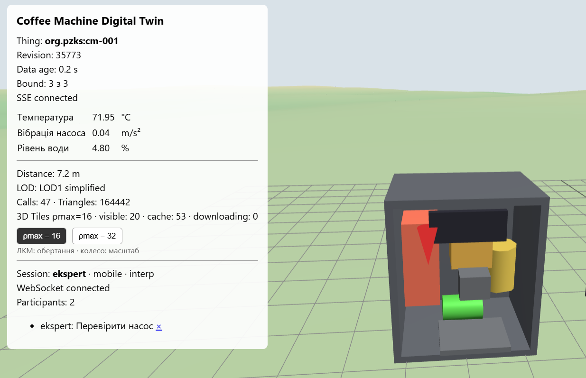

# Багатокористувацьке середовище

## Спільний стан

| Складник | Як змінюється | Чи можна пропустити оновлення | Джерело істини |
|---|---|---|---|
| Телеметрія кавомашини | Емулятор надсилає відліки через MQTT, стан читається через REST/SSE | Для поточного подання так, наступний повний стан його замінює | Eclipse Ditto |
| Поза аватара | Клієнт передає позицію й орієнтацію камери приблизно 20 разів за секунду | Так, якщо в буфері лишаються два придатні знімки | Клієнт задає позу, сервер перевіряє і розсилає її |
| Позначки | Сервер додає їх та дозволяє видалення сеансу автора | Окрему команду пропускати не можна. Повний список замінює попередній | Сервер сеансу |

Позначки живуть до перезапуску сервера. Після перепідключення учасник бачить попередні позначки, але отримує новий ідентифікатор сеансу.

Сервер працює за адресою:

```text
ws://127.0.0.1:8091
```

Період формування знімків стану становить 50 мс, тобто 20 Гц.

## Сценарій

У сцені передбачено декілька ролей.

Інженер оглядає цифровий двійник кавомашини, переміщує камеру та може залишати позначки біля компонентів, які потребують перевірки.

Експерт підключається до того самого сеансу та бачить:

- положення інженера;
- положення інших учасників;
- бота з відомою траєкторією;
- спільні позначки.

Кожен учасник представлений у сцені аватаром. Положення камери клієнта передається серверу 20 разів за секунду.

Для створення спільної позначки користувач двічі клацає по елементу сцени та вводить текст. Позначка зберігається сервером і розсилається всім учасникам.

Видалити позначку може лише її автор.

Під час перевірки була створена позначка:

```text
Перевірити насос
```

Вона успішно відобразилася у спільній сцені.



Повторна перевірка у двох вікнах Chrome з ботом підтвердила, що обидва клієнти бачать два віддалені аватари та одну позначку. Після видалення автором вона зникла в обох вікнах.

Для трьох учасників середній JSON-знімок у двох браузерах займав 300 байтів на дві пози разом зі службовими полями. За `N = 3`, `K = 2`, `f = 20 Гц` та `s ≈ 150 байтів` оцінка `Rс = 8·N·K·f·s` дає 144 кбіт/с. Сервер за один повний п’ятисекундний інтервал з трьома учасниками зафіксував 129 кбіт/с корисних даних, приблизно на 10% нижче оцінки. У розрахунку використано номінальні 20 Гц і середній розмір з двох клієнтів.

## Синхронізація аватарів

Сервер формує знімки стану кожні:

```text
Tзн = 50 мс
```

Клієнт зберігає останні знімки у буфері.

Для режиму інтерполяції затримка буфера визначається як:

```text
Dінт = (m + 1) * Tзн + J
```

де:

- `m` - кількість послідовно втрачених знімків, яку має витримувати буфер;
- `Tзн` - період знімків;
- `J` - джитер.

Положення аватара між двома знімками визначається лінійною інтерполяцією.

Орієнтація визначається сферичною інтерполяцією кватерніонів.

У режимі `extrap` клієнт замість затриманого показу продовжує останній відомий рух. Екстраполяція обмежена 250 мс.

## Профілі мережі

Використано три мережеві профілі:

| Профіль | RTT, мс | Джитер, мс | Втрата | m |
|---|---:|---:|---:|---:|
| LAN | 2 | 1 | 0% | 0 |
| City | 20 | 5 | 0.5% | 1 |
| Mobile | 60 | 30 | 2% | 1 |

Сервер моделює затримку в обидва боки. У разі модельної втрати сегмента додається додатковий RTT, що імітує повторне передавання TCP.

### Розрахункова затримка

Затримка показу дії іншого учасника оцінюється як:

```text
LАБ = L↑ + tоч + L↓ + Dінт
```

Для бота:

```text
L↑ ≈ 1 мс
tоч = Tзн / 2 = 25 мс
L↓ = RTT / 2
```

### LAN, interpolation

```text
Dінт = (0 + 1) * 50 + 1 = 51 мс

LАБ = 1 + 25 + 1 + 51
     = 78 мс
```

### City, interpolation

```text
Dінт = (1 + 1) * 50 + 5 = 105 мс

LАБ = 1 + 25 + 10 + 105
     = 141 мс
```

### Mobile, interpolation

```text
Dінт = (1 + 1) * 50 + 30 = 130 мс

LАБ = 1 + 25 + 30 + 130
     = 186 мс
```

### Mobile, extrapolation

Для екстраполяції додаткова затримка інтерполяційного буфера відсутня:

```text
Dінт = 0

LАБ = 1 + 25 + 30
     = 56 мс
```

### Результати вимірювань

| Профіль і режим | RTT p50, мс | Dінт, мс | LАБ розрах., мс | Delay p50, мс | Delay p95, мс | Без нового snapshot, % | Макс. відхилення, м |
|---|---:|---:|---:|---:|---:|---:|---:|
| LAN, interpolation | 24 | 51 | 78 | 100 | 124 | 31.4 | 0.002 |
| City, interpolation | 35 | 105 | 141 | 166 | 182 | 0.0 | 0.002 |
| Mobile, interpolation | 114 | 130 | 186 | 208 | 228 | 0.4 | 0.002 |
| Mobile, extrapolation | 106 | 0 | 56 | 74 | 136 | 100.0* | 8.983 |

\* У режимі екстраполяції показник `starved_pct` не має того самого змісту, що для інтерполяції. Клієнт навмисно відображає стан у момент, новішого snapshot для якого ще немає, і продовжує останній рух. Тому цей показник не використовується як критерій якості режиму extrapolation.

### Аналіз результатів

Виміряні медіанні затримки були більші за розрахункові:

- LAN: на 22 мс;
- City: на 25 мс;
- Mobile interpolation: на 22 мс;
- Mobile extrapolation: на 18 мс.

Також виміряний RTT виявився більшим за модельний. На результат впливають джитер, повторні передавання, робота таймерів JavaScript та навантаження браузера під час рендерингу 3D-сцени.

У збережених прогонах максимум відхилення для інтерполяції становив 0,002 м. Для Mobile екстраполяція зменшила медіанну затримку з 208 до 74 мс. Затримку оцінено пошуком найближчої точки за останні 600 мс. Старий збір міг захопити кадри, коли позу бота ще не встановлено, тож максимум 8,983 м потребує повторного виміру. Число в таблиці взято із збереженого JSON.

## Архітектурні обмеження

- LAN має медіанну затримку 100 мс. Буфер 51 мс залишив 31,4% кадрів без новішого знімка. Для швидких рухів у локальному профілі варто перевірити більший буфер.
- City із буфером 105 мс дав 166 мс медіанної затримки й 0% кадрів без новішого знімка. Цього достатньо для огляду й позначок. Mobile з інтерполяцією дав 208 мс, тож узгоджувати дії, для яких потрібна миттєва реакція, складніше.
- У Mobile буфер становить 130 мс. У моделі одне повторне передавання додає ще 60 мс, а впорядкування затримує наступні знімки. Невпорядкований канал був би доречним для поз, де новий знімок замінює пропущений. Позначкам потрібна надійна доставка.
- За частоти 20 Гц число поз у всіх вихідних знімках пропорційне `N(N−1)`: 3 учасники дають 120 поз/с, а 10 дають 1800 поз/с. Для більшого сеансу варто надсилати лише аватари поблизу спостерігача.
- Знімки надсилаються кожні 50 мс. Після зупинки сервера сеансу аватари й позначки перестають оновлюватися, а телеметрія Ditto продовжує надходити через незалежний канал. Команди кавомашині потребували б окремого каналу з перевіркою прав, актуальності та підтвердження виконання.
