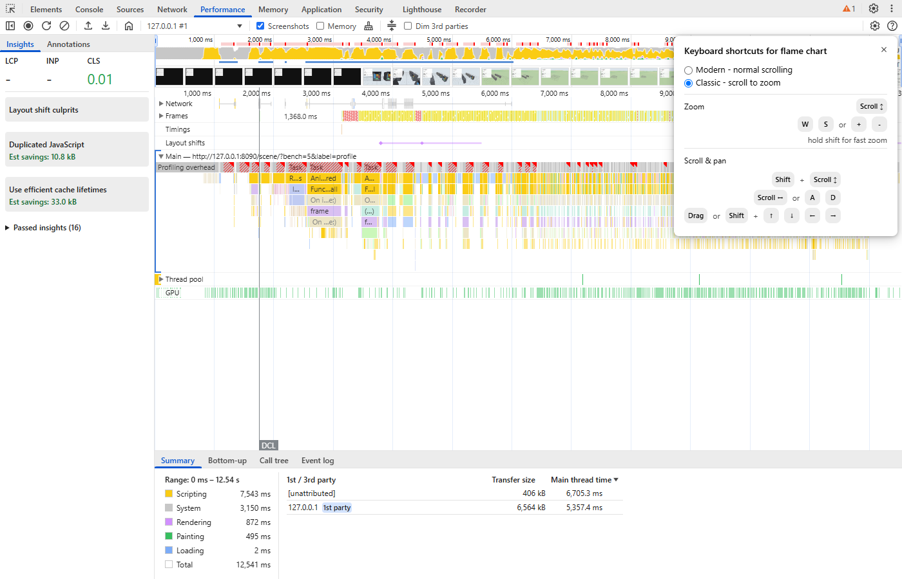

# Продуктивність 3D-візуалізації

## Бюджет

Цільовий клієнт — комп’ютер з інтегрованою графікою й дисплеєм 60 Гц. У контрольному записі Chrome використовував Intel UHD Graphics (ANGLE, Direct3D 11). Для початкових п’яти прогонів GPU окремо не зафіксовано.

Бюджет одного кадру:

```text
1000 / 60 ≈ 16,67 мс
```

Для моделювання слабшого процесора в Chromium DevTools використано:

```text
CPU throttling: 6×
```

Роздільна здатність benchmark:

```text
1920 × 1080
```

Перед кожним прогоном кеш браузера вимикався через `Disable cache`.

Бюджет:

| Показник | Ціль | Підстава | Поле результату |
|---|---:|---|---|
| Кадри в бюджеті | ≥ 99% з `max(TCPU, TGPU) ≤ 16,67 мс` | Дисплей 60 Гц, бюджет кадру 16,67 мс | `in_budget_pct` |
| Draw calls | ≤ 50 | Модельна оцінка: (16,67 − 6) / 0,2 ≈ 53, ліміт округлено до 50 | `calls_max` |
| Трикутники | ≤ 300 000 | Модельний ліміт для клієнта з інтегрованою графікою | `triangles_max` |
| Пам'ять текстур | ≤ 16 МБ | Модельний бюджет пам’яті текстур для цієї сцени | `textures_mb` |
| Дані до першого кадру | ≤ 1,9 МБ | Приблизно 3 с за 5 Мбіт/с | `data_first_frame_mb` |

## Профілювання

На скриншоті — окремий короткий запис сцени без оптимізацій, з уповільненням ЦП 6× і вимкненим кешем. Числа в таблицях взято з початкових 30-секундних прогонів.



Benchmark реалізовано в:

```text
scene/bench.js
```

Виконується:

- 3 с прогріву;
- 30 с вимірювання;
- однакова автоматична траєкторія камери;
- фіксована роздільна здатність;
- вимірювання CPU і GPU;
- draw calls;
- triangles;
- Resource Timing.

Початковий прогін:

```text
?bench=30&label=before
```

Результат:

| Показник | До оптимізацій | Бюджет | Стан |
|---|---:|---:|---|
| FPS | 19,5 | — | — |
| Frame p50 | 50,0 мс | — | — |
| Frame p99 | 133,4 мс | — | — |
| CPU p50 | 21,9 мс | ≤ 16,67 мс* | не виконано |
| CPU p99 | 56,1 мс | — | — |
| GPU p50 | 15,58 мс | ≤ 16,67 мс* | виконано |
| GPU p99 | 17,99 мс | — | — |
| Кадри в бюджеті | 22,4% | ≥ 99% | не виконано |
| Calls max | 70 | ≤ 50 | не виконано |
| Triangles max | 229 376 | ≤ 300 000 | виконано |
| Textures | 0 МБ | ≤ 16 МБ | виконано |
| Data before first frame | 0,93 МБ | ≤ 1,9 МБ | виконано |

\* Остаточний критерій бюджету визначається як `max(TCPU, TGPU) ≤ 16,67 мс`.

Основні вузькі місця:

| Показник | Причина | Оптимізація |
|---|---|---|
| `calls_max = 70` | багато окремих Mesh для восьми кавомашин | instancing |
| CPU p50 = 21,9 мс | оброблення сцени, LOD, tiles та draw calls при CPU 6× | instancing, simplification |
| Data first frame = 0,93 МБ | моделі та ресурси завантажуються до першого кадру | deferred loading |

Кількість трикутників та пам'ять текстур не були критичними.

Окреме KTX2-стиснення не застосовувалось, оскільки модель використовує прості матеріали без текстур, а `textures_mb = 0`.

Результат початкового benchmark збережено в:

```text
results/perf-before.json
```

## Оптимізації

Застосовано три оптимізації.

### Instancing

Параметр:

```text
opt=inst
```

Однакові частини восьми кавомашин об'єднуються через `THREE.InstancedMesh`.

Мета оптимізації — зменшити кількість draw calls.

Результат:

```text
calls_max: 70 → 29
```

тобто максимальна кількість викликів зменшилася приблизно на 58,6%.

Вартість оптимізації:

- складніша робота з кольорами окремих екземплярів;
- LOD застосовується до інстансованої групи;
- оптимізація не гарантує зменшення кількості трикутників.

### Simplification

Параметр:

```text
opt=simp
```

Замість детальної моделі використовується:

```text
coffee-machine-lod1.glb
```

Модель була попередньо спрощена через `gltfpack`.

Вартість оптимізації — менша геометрична деталізація моделі.

У цьому benchmark ефект виявився малим, оскільки основну частину геометричного навантаження створює потоковий рельєф 3D Tiles.

### Deferred loading

Параметр:

```text
opt=defer
```

До першого кадру використовується легша модель, а детальна геометрія та потокові ресурси починають завантажуватися після появи першого кадру.

Результат:

```text
data_first_frame:
0,93 МБ → 0,66 МБ
```

Зменшення становить приблизно 29%.

Вартість оптимізації — детальні ресурси можуть з'являтися трохи пізніше після відкриття сцени.

## До і після

Окремі прогони:

| Конфігурація | FPS | CPU p50, мс | GPU p50, мс | У бюджеті, % | Calls max | Triangles max | Data first frame, МБ |
|---|---:|---:|---:|---:|---:|---:|---:|
| before | 19,5 | 21,9 | 15,58 | 22,4 | 70 | 229 376 | 0,93 |
| inst | 18,6 | 22,2 | 15,56 | 24,6 | 29 | 229 376 | 0,93 |
| simp | 18,8 | 22,3 | 15,75 | 17,2 | 70 | 229 376 | 0,88 |
| defer | 18,2 | 22,5 | 15,48 | 19,6 | 70 | 229 376 | 0,66 |
| inst + simp + defer | 19,9 | 20,8 | 15,49 | 28,0 | 29 | 229 376 | 0,66 |

Порівняння фінальної конфігурації з початковою:

| Показник | До | Після | Зміна |
|---|---:|---:|---|
| FPS | 19,5 | 19,9 | +2,1% |
| CPU p50 | 21,9 мс | 20,8 мс | -5,0% |
| GPU p50 | 15,58 мс | 15,49 мс | -0,6% |
| Кадри в бюджеті | 22,4% | 28,0% | +5,6 в.п. |
| Calls max | 70 | 29 | -58,6% |
| Triangles max | 229 376 | 229 376 | без змін |
| Data first frame | 0,93 МБ | 0,66 МБ | -29,0% |

Фінальний результат:

```text
results/perf-after.json
```

Окремі результати:

```text
results/perf-inst.json
results/perf-simp.json
results/perf-defer.json
```

GPU p99 у порядку before / inst / simp / defer / after: 17,99 / 18,66 / 17,96 / 17,97 / 18,47 мс. CPU p99: 56,1 / 63,0 / 65,5 / 58,0 / 58,9 мс. Текстури в усіх п’яти прогонах займали 0 МБ.

## Висновок

Після оптимізацій виконуються бюджети:

```text
draw calls ≤ 50
triangles ≤ 300 000
textures ≤ 16 МБ
data before first frame ≤ 1,9 МБ
```

Найбільший ефект дало інстансування:

```text
70 → 29 draw calls
```

Deferred loading зменшив обсяг даних до першого кадру:

```text
0,93 → 0,66 МБ
```

Simplification майже не вплинув на загальну продуктивність, оскільки основне геометричне навантаження в benchmark створює 3D Tiles.

Ціль:

```text
≥ 99% кадрів у бюджеті 16,67 мс
```

не досягнуто.

Після всіх оптимізацій у бюджет вкладалося 28% кадрів.

Основним вузьким місцем залишається CPU. При моделюванні слабшого процесора через `6× CPU throttling` медіанний CPU time становив 20,8 мс, що перевищує бюджет 16,67 мс.

GPU p50 знаходиться в межах бюджету, хоча p99 періодично перевищує його.

Наступний крок — перевірити агресивніший LOD для рельєфу та рідше оновлювати HUD. Збережені JSON отримано до уточнення 30-секундного вікна benchmark і перевірки повноти GPU-замірів. Порівняння стосується цих п’яти прогонів.

Короткий повторний прогін у Chrome 157 з усіма оптимізаціями дав 154 GPU-замірів на 154 кадри. Це перевірка збору даних, для порівняння вище використано збережені 30-секундні прогони.
