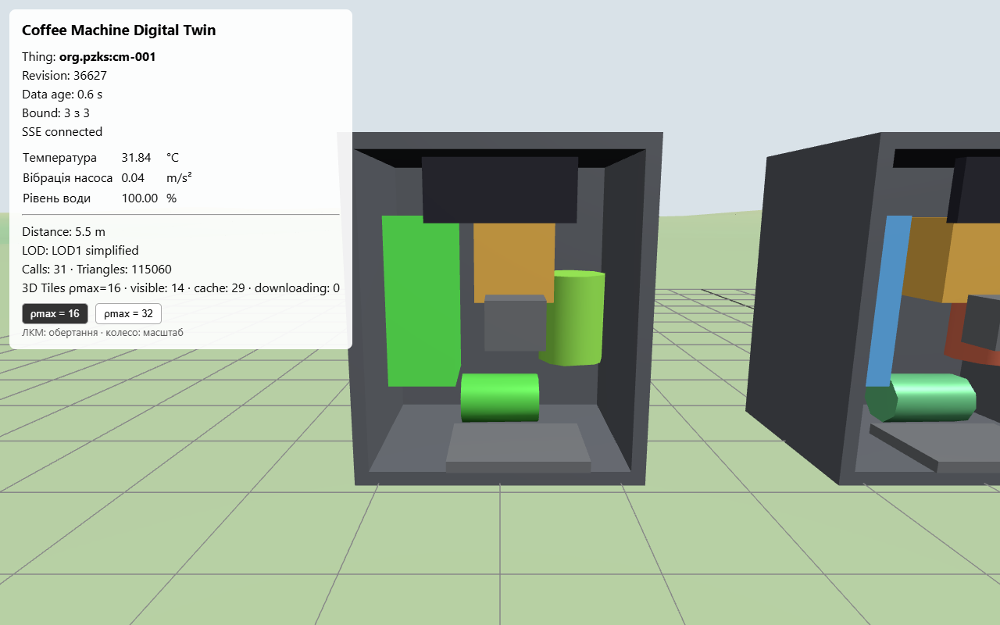

# 3D-сцена цифрового двійника

## Модель і ідентифікатори

Навчальну модель кавомашини зібрано з примітивів у `scene/tools/make-model.mjs`. Модель власна, окрему ліцензію для неї не зазначено. Сторонніх моделей і текстур немає. Детальний GLB займає 47 072 байти, спрощений — 11 068 байтів. Команди підготовки з каталогу `scene`:

```powershell
node tools/make-model.mjs
npx --no-install gltfpack -i models/coffee-machine.glb -o models/coffee-machine-lod1.glb -si 0.1 -kn -ke
node tools/elements.mjs models/coffee-machine.glb models/coffee-machine-lod1.glb
```

| `extras.element` | Деталь | Властивість Ditto |
|---|---|---|
| `body` | Корпус | — |
| `water-tank` | Бак води | `hydraulics.waterLevel` |
| `pump` | Насос | `hydraulics.pumpVibrationRms` |
| `heater` | Нагрівач | `thermal.temperature` |
| `brewing-unit` | Заварювальний блок | — |
| `outlet` | Вихід напою | — |
| `control-panel` | Панель керування | — |
| `cup-tray` | Піддон | — |

## Прив’язка телеметрії

Вузол GLB ідентифікується через `extras.element`. Якщо сітка вкладена в неіменований вузол, сцена шукає ідентифікатор у батьківських вузлах. `binding.json` пов’язує три деталі `machine-1` із властивостями `org.pzks:cm-001`. Перший стан читається через REST, далі надходять події SSE. Колір змінюється лише в прив’язаній кавомашині. За низького рівня води бак червоніє. Після паузи в телеметрії панель показує давність, а деталі зберігають останній колір.



## Рівні деталізації та відсікання

| Рівень | Початкова відстань | Трикутники на кавомашину |
|---|---:|---:|
| LOD0, детальна модель | 0 м | 632 |
| LOD1, спрощена модель | 5 м | 186 |
| LOD2, габаритний блок | 15 м | 12 |
| LOD3, порожній об’єкт | 35 м | 0 |

Пороги менші, ніж у прикладі з насосною станцією, бо тут оглядаємо компактну кавомашину. За висоти кадру 800 px, вертикального поля зору 60° та допуску 16 px відстані 5 і 15 м відповідають допустимій геометричній похибці приблизно 9 і 28 см за формулою екранної похибки. Це оцінка для вибору порогів. Похибку сітки окремо не вимірювали. На переходах до LOD1 і LOD2 є гістерезис 10%. При `opt=inst` рівень для групи вибирається за відстанню до її центру, з порогами 10, 30 і 70 м.

Параметр `cull=0` вимикає відсікання за пірамідою видимості для вже створеної геометрії сцени. Вибір тайлів і відсікання моделей за відстанню працюють далі. Матеріали GLB односторонні.

Вимірювання виконано у Chrome 157 у вікні 1280 × 800 після завершення завантаження тайлів. В обох варіантах `ρmax = 16 px`.

| Вид | Відсікання | Виклики рисування | Трикутники | LOD першої машини |
|---|---|---:|---:|---|
| near | так | 31 | 115 060 | LOD1 |
| near | ні | 79 | 116 622 | LOD1 |
| hall | так | 32 | 131 342 | LOD2 |
| hall | ні | 32 | 131 342 | LOD2 |
| far | так | 20 | 155 648 | LOD3 |
| far | ні | 20 | 155 648 | LOD3 |

У ближньому виді відсікання прибрало 48 із 79 викликів. Число трикутників змінилося мало, бо більшість припадає на рельєф.

## Потокове завантаження

`npm --prefix scene run tiles` генерує квадродерево 3D Tiles 1.1 у `scene/tiles/site/v1/`. У наборі 341 тайл, близько 40,3 МБ і 2,79 млн трикутників. Увесь набір перевищує ліміт кешу 32 МіБ.

| Рівень | Сторона тайла, м | Крок сітки, м | Геометрична похибка, м | Відстань уточнення, м | Тайлів |
|---|---:|---:|---:|---:|---:|
| 0 | 2048 | 32 | 32 | 1871 | 1 |
| 1 | 1024 | 16 | 16 | 935 | 4 |
| 2 | 512 | 8 | 8 | 468 | 16 |
| 3 | 256 | 4 | 4 | 234 | 64 |
| 4 | 128 | 2 | 0 | — | 256 |

Відстані розраховано для висоти кадру 1080 px, поля зору 60° та `ρmax = 16 px`: `d = G·H / (2·ρmax·tan(θ/2))`. За `ρmax = 32 px` ці відстані вдвічі менші. Після досягнення ліміту кеш звільняє невикористані тайли. При поверненні камери до цієї ділянки вони можуть завантажитися повторно. Поки потрібні детальні тайли завантажуються, рендерер може тримати грубіший рівень.


У холодному кеші за `ρmax = 16 px` вид near завантажив 29 із 341 тайла (8,5%), hall і far — по 53 (15,5%). На far після перемикання на 32 px кількість видимих тайлів зменшилася з 19 до 16, а трикутників — зі 155 648 до 131 072. Кеш у цьому прогоні залишився на 53 тайлах, оскільки поріг змінили без перезавантаження сторінки.
