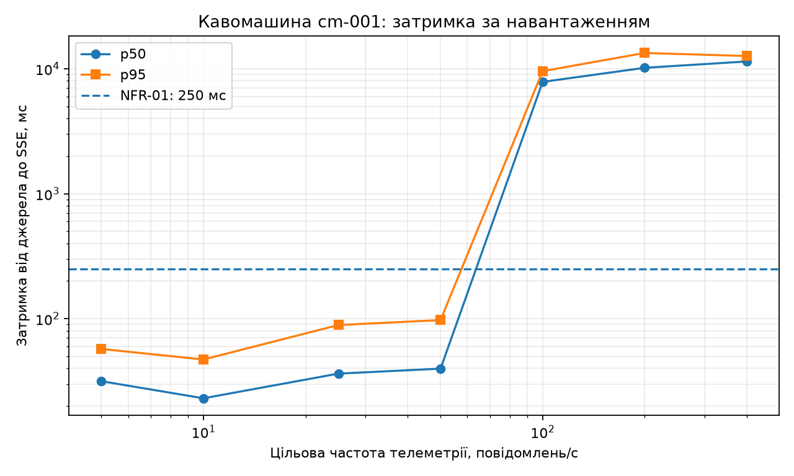

# Синхронізація стану та навантажувальне тестування

**Лабораторна робота:** № 2, заняття 4.

**Об'єкт:** цифровий двійник автоматичної кавомашини `org.pzks:cm-001`.

**Стенд:** Python-емулятор → Mosquitto (QoS 1) → Eclipse Ditto 3.9.7 → SSE → InfluxDB 2.9 → Grafana 13.0.

## Методика вимірювань

- Емулятор формує агрегований знімок **8 сигналів** у `coffee-machine/cm-001/telemetry`; поля `seq` та `ts` ідентифікують повідомлення і час джерела.
- `sync/historian.py` слухає Ditto SSE API за адресою `/api/2/things?ids=org.pzks:cm-001&fields=thingId,features,_revision` і записує оновлення до InfluxDB: measurement `twin_state`, тег `thing`, поля восьми сигналів, `seq`, `sync_ms`, за наявності `_revision` — `revision`.
- Затримка синхронізації: `L = t_SSE − t_джерела` у мілісекундах. Час отримання події через API є наближенням моменту доступності нового стану в API. В обох випадках мітки беруться за годинником одного хост-комп'ютера.
- InfluxDB зберігає дані в bucket `twin` з політикою зберігання **7 діб**. Наносекундна частина мітки формується з `seq`, щоб події з одним `ts` (точність 1 мс) не перезаписували одна одну.
- Для оцінки використовуються `p50` (медіана), `p95` (95-й процентиль), частка відсутніх записів `ε = 1 − N_отр / N_над` та фактична частота публікації. Успішний MQTT `PUBACK` сам по собі не підтверджує застосування оновлення у Ditto.
- Ціль NFR-01 із ЛР1: **p95 ≤ 250 мс**. Формальна перевірка вимоги передбачає 30-хвилинну вибірку. Тут наведено коротші прогони.

## Збереження історії в InfluxDB

Підготуйте [стенд і MQTT-з’єднання](../README.md#лр2-локальний-стенд-і-перевірки). У двох терміналах PowerShell відкрийте корінь репозиторію та активуйте `.venv`.

**Термінал 1 (не зупиняти до кінця вимірювань):**

```powershell
.\.venv\Scripts\Activate.ps1
python sync/historian.py
```

Після повідомлення «Підключено до SSE» у **терміналі 2**:

```powershell
.\.venv\Scripts\Activate.ps1
$env:LAB2_RESULTS_DIR = "results/history-$(Get-Date -Format yyyyMMdd-HHmmss)"
python emulator/emulator.py --rate 1 --count 60
Start-Sleep -Seconds 3
python sync/consistency.py
Remove-Item Env:LAB2_RESULTS_DIR
```

Для перегляду історії відкрийте `http://localhost:3000` (навчальний логін `admin/admin`). У Grafana виберіть Dashboard → Add visualization → InfluxDB (Flux) і додайте запит для температури й тиску:

```flux
from(bucket: "twin")
  |> range(start: v.timeRangeStart, stop: v.timeRangeStop)
  |> filter(fn: (r) => r._measurement == "twin_state")
  |> filter(fn: (r) => r._field == "temperature" or r._field == "pressure")
  |> aggregateWindow(every: v.windowPeriod, fn: mean, createEmpty: false)
```

Друга панель для затримки:

```flux
from(bucket: "twin")
  |> range(start: v.timeRangeStart, stop: v.timeRangeStop)
  |> filter(fn: (r) => r._measurement == "twin_state" and r._field == "sync_ms")
  |> aggregateWindow(every: v.windowPeriod, fn: max, createEmpty: false)
```

Обидва запити є в [експорті дашборда Grafana](../platform/grafana-dashboard.json). Відображення повної 60-секундної історії окремо не підтверджено.

## Перевірка узгодженості

`sync/consistency.py` порівнює повідомлення, підтверджені брокером і записані у `source.csv` вибраного каталогу, з InfluxDB та кінцевим станом через Ditto API. Пара `(seq, ts)` відрізняє відліки між запусками. Перевіряються:

1. Повнота за `seq`, відсутні номери повідомлень.
2. Рівність шести числових та двох булевих показників.
3. Порядок `seq` відповідно до ревізій Ditto (якщо `_revision` доступний).
4. Відповідність кінцевого стану останньому повідомленню, включно з `seq/ts`.
5. Затримки `p50/p95` від джерела до SSE API.

Збережені результати контрольних прогонів:

| Сценарій | PUBACK | В історії | Кінцевий стан збігся | p50 / p95, мс |
|---|---:|---:|---|---:|
| [Коректне відображення](../results/consistency.md) | 10 | 10 (100 %) | Так | 116,0 / 218,8 |
| [Контрольний прогін, 10 повідомлень/с](../results/normal-20261112-141529/consistency.md) ([відліки](../results/normal-20261112-141529/source.csv)) | 300 | 300 (100 %) | Так | 47,9 / 76,2 |
| [Температура 150 °C у відображенні](../results/consistency-invalid.md) | 10 | 0 (0 %) | Ні | — |

У прогоні на 300 відліків збіглися всі вісім значень, пропусків ревізій і порушень порядку не виявлено. Результат негативного прогону узгоджується з відхиленням оновлення за WoT-моделлю, де максимальна температура становить 100 °C.

Для контрольного прогону на 300 відліків залиште історик запущеним. Унікальний каталог відокремить нові файли від збережених результатів.

```powershell
$env:LAB2_RESULTS_DIR = "results/normal-$(Get-Date -Format yyyyMMdd-HHmmss)"
python emulator/emulator.py --rate 10 --count 300
Start-Sleep -Seconds 3
python sync/consistency.py
Remove-Item Env:LAB2_RESULTS_DIR
```

Для негативного прогону команди підставляють `temperature: 150` у `platform/mapping.js` і відновлюють початкове відображення після тесту.

```powershell
$mapping = (Resolve-Path platform/mapping.js).Path
$original = [IO.File]::ReadAllBytes($mapping)
$valid = [IO.File]::ReadAllText($mapping)
if (-not $valid.Contains('temperature: data.temp')) { throw 'Перевірте поточний mapping.js' }
$env:LAB2_RESULTS_DIR = "results/invalid-$(Get-Date -Format yyyyMMdd-HHmmss)"
try {
    [IO.File]::WriteAllText($mapping, $valid.Replace('temperature: data.temp', 'temperature: 150'))
    python platform/connection.py
    if ($LASTEXITCODE) { throw 'Не вдалося застосувати тестове відображення' }
    python emulator/emulator.py --rate 1 --count 10
    if ($LASTEXITCODE) { throw 'Емулятор завершився помилкою' }
    Start-Sleep -Seconds 3
    python sync/consistency.py
} finally {
    [IO.File]::WriteAllBytes($mapping, $original)
    Remove-Item Env:LAB2_RESULTS_DIR
    python platform/connection.py
    if ($LASTEXITCODE) { throw 'Повторіть connection.py для відновлення відображення в Ditto' }
}
```

Перед тестом навантаження переконайтеся, що після відновлення коректного відображення новий відлік знову з'являється у Ditto та історії.

## Навантажувальне тестування

Locust моделює шлюзи MQTT: один користувач намагається надсилати 5 повідомлень/с, кількість користувачів зростає ступенями `1, 2, 5, 10, 20, 40, 80`. Відповідні цільові частоти: **5, 10, 25, 50, 100, 200, 400 повідомлень/с** на один цифровий двійник. Кожен вимірювальний ступінь триває 60 секунд. Locust працює в одному локальному процесі та записує цільову частоту кожної публікації в `sent.csv`. Аналіз зіставляє відліки за парою `(seq, ts)`.

Під час тесту звичайний емулятор має бути зупинений, а історик — працювати. Прогрів і вимірювальний прогін виконуються послідовно.

```powershell
$env:LAB2_RESULTS_DIR = "results/warmup-$(Get-Date -Format yyyyMMdd-HHmmss)"
$env:STEP_TIME = '10'
python -m locust -f load/locustfile.py --headless --only-summary --stop-timeout 6
Remove-Item Env:STEP_TIME

$env:LAB2_RESULTS_DIR = "results/load-$(Get-Date -Format yyyyMMdd-HHmmss)"
python -m locust -f load/locustfile.py --headless --stop-timeout 6 --csv "$env:LAB2_RESULTS_DIR/locust" --html "$env:LAB2_RESULTS_DIR/locust.html"
```

Locust вимірює час до `PUBACK`. Затримку до отримання стану через SSE обчислює історик. Для оцінки синхронізації після завершення тесту залиште історику кілька секунд на запис буфера й виконайте:

```powershell
Start-Sleep -Seconds 5
python load/analyze.py
Remove-Item Env:LAB2_RESULTS_DIR
```

Повний прогін створює `locust_stats.csv`, `locust.html`, `sent.csv`, `load.csv` і `latency_vs_load.png` у вибраному каталозі. `actual_rate` — кількість спроб публікації за секунду запланованого ступеня, `without_puback` — кількість спроб без підтвердження, `loss_pct` — частка спроб, для яких відсутній відповідний запис історика. Перевірте наявність усіх семи ступенів, помилки Locust та відповідність `actual_rate` цільовій `rate`. Якщо фактична частота суттєво відстає, перевірте генератор та MQTT-канал перед оцінкою пропускної здатності Ditto. Якщо до 400 повідомлень/с затримка не зростає і генератор досягає цілі, методичка передбачає додаткові ступені зі 160 та 320 шлюзами в окремому прогоні.

### Результати вимірювань

| Цільова частота, повід./с | Фактична частота, повід./с | Надіслано | Є в історії | Відсутні в історії, % | p50, мс | p95, мс |
|---:|---:|---:|---:|---:|---:|---:|
| 5 | 5,00 | 300 | 300 | 0 | 31,60 | 57,20 |
| 10 | 9,97 | 598 | 598 | 0 | 23,06 | 47,12 |
| 25 | 24,80 | 1 488 | 1 488 | 0 | 36,34 | 88,95 |
| 50 | 49,83 | 2 990 | 2 990 | 0 | 39,82 | 97,42 |
| 100 | 96,73 | 5 804 | 5 804 | 0 | 7 849,03 | 9 566,71 |
| 200 | 195,12 | 11 707 | 6 171 | 47,29 | 10 176,68 | 13 375,18 |
| 400 | 380,57 | 22 834 | 5 358 | 76,53 | 11 433,39 | 12 643,21 |

Журнал містить 45 721 публікацію з MQTT PUBACK. Останній знімок статистики Locust містить 45 602 запити та 0 помилок. Для таблиці використано повний журнал публікацій. [Підсумковий CSV](../results/load.csv), [журнал публікацій](../results/sent.csv), [звіт Locust](../results/locust.html).



## Висновок щодо масштабованості

1. Найвища виміряна частота, за якої p95 лишався нижчим за 250 мс і всі записи потрапили в історію, становила **49,83 повідомлення/с**. На цьому 60-секундному ступені p95 = 97,42 мс.
2. Різке зростання затримки спостерігається між **49,83 і 96,73 повідомлення/с**. На вищому з цих ступенів усі 5 804 записи потрапили в історію, а p95 зріс до 9,57 с. Стрибок узгоджується з накопиченням черги. На двох наступних ступенях в історії відсутні 47,29 % і 76,53 % записів, хоча MQTT підтвердив усі публікації. Для локалізації вузького місця потрібне окреме зіставлення ревізій Ditto, подій SSE і записів InfluxDB. NFR-06 у цьому тесті не підтверджено.
3. Для більшої кількості кавомашин можна розподіляти примірники між вузлами Ditto та окремо масштабувати брокер і історик. Для частіших вимірювань однієї кавомашини варто перевірити агрегацію на шлюзі, щоб зменшити кількість оновлень одного thing і зберегти потрібну деталізацію.

Для перевірки NFR-03 потрібен окремий експеримент зі збільшенням кількості сигналів з 8 до 80. У цьому тесті змінювали частоту публікацій за сталого набору сигналів.
