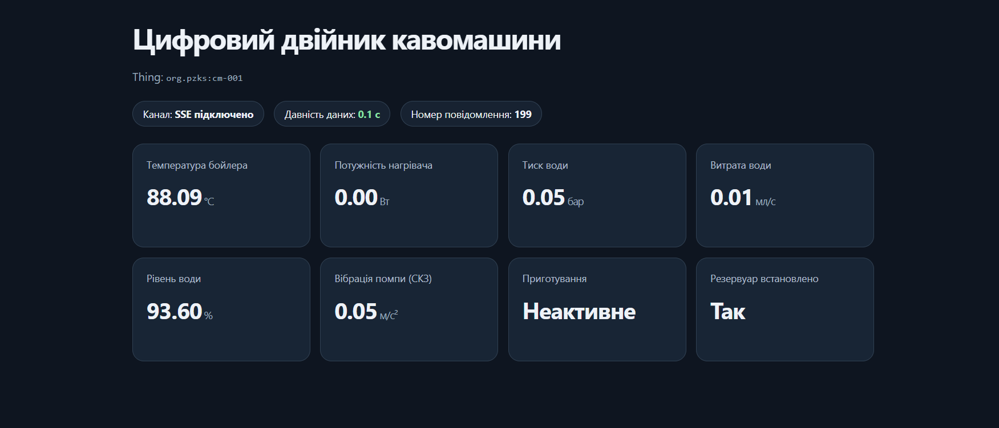

# Канал телеметрії IoT та вебподання цифрового двійника

**Лабораторна робота:** № 2, заняття 3.  
**Об'єкт:** автоматична кавомашина `org.pzks:cm-001`.  
**Платформа:** Mosquitto 2, Eclipse Ditto 3.9.7, nginx.

## Мета

Реалізувати передачу даних від емулятора датчиків кавомашини через MQTT до Eclipse Ditto, відобразити їх на функціональні блоки Thing Model та показати актуальний і застарілий стан у вебподанні.

## Канал телеметрії

Маршрут: `emulator/emulator.py` → `Mosquitto` → `Ditto connectivity / mapping.js` → `org.pzks:cm-001` → `SSE/REST API` → `ui/index.html`.

- Емулятор працює в домені спостережуваного об'єкта (OME).
- MQTT-брокер та JavaScript-відображення належать до домену зв'язку з пристроями (DCE).
- Eclipse Ditto зберігає актуальний стан двійника в домені DTE.
- Вебподання працює в домені користувача (UE).

## Перевірка брокера

Виконано тест публікації і підписки Mosquitto:

```powershell
docker compose -f platform/docker-compose.yml exec -T mosquitto mosquitto_sub -t "coffee-machine/#" -v
docker compose -f platform/docker-compose.yml exec -T mosquitto mosquitto_pub -t "coffee-machine/test" -m "Hello MQTT"
```

Підписник отримав `coffee-machine/test Hello MQTT`.

## Схема повідомлення

**Тема:** `coffee-machine/cm-001/telemetry` (підписка Ditto: `coffee-machine/+/telemetry`).  
**QoS:** 1, тобто підтвердження приймання від брокера (`PUBACK`).  
**Формат:** UTF-8 JSON, один агрегований знімок на повідомлення.

Приклад повідомлення:

```json
{
  "seq": 1,
  "ts": 1794160000000,
  "temp": 25.1,
  "hp": 1350.0,
  "p": 0.05,
  "flow": 0.0,
  "level": 100.0,
  "vib": 0.041,
  "brew": false,
  "tank": true
}
```

| Поле | Сигнал ЛР1 | Тип | Одиниця | Діапазон / точність | Властивість Ditto |
|---|---|---|---|---|---|
| `temp` | S01 Temperature | number | °C | 20–100, 0,01 | `thermal.temperature` |
| `p` | S02 Pressure | number | bar | 0–12, 0,001 | `hydraulics.pressure` |
| `flow` | S03 FlowRate | number | мл/с | 0–5, 0,001 | `hydraulics.flowRate` |
| `level` | S04 WaterLevel | number | % | 0–100, 0,01 | `hydraulics.waterLevel` |
| `hp` | S05 HeaterPower | number | Вт | 0–1500, 0,1 | `thermal.heaterPower` |
| `vib` | S06 PumpVibrationRms | number | м/с² | 0–3, 0,001 | `hydraulics.pumpVibrationRms` |
| `brew` | S07 BrewingActive | boolean | — | false / true | `operation.brewingActive` |
| `tank` | S08 WaterTankPresent | boolean | — | false / true | `operation.waterTankPresent` |
| `seq` | Службове поле | integer | — | ≥ 0, без пропусків в одному сеансі | `sync.seq` |
| `ts` | Службове поле | integer | мс Unix UTC | ≥ 0, час джерела | `sync.ts` |

Для S02, S03 використовується середнє значення з 10 модельованих підвідліків за знімок; для S06 — середньоквадратичне значення 10 підвідліків. Емулятор оновлює S04 кожні 10 с і передає останній відлік між вимірюваннями. S08 в емуляторі має стале значення `true`. Частота публікації стану за замовчуванням — 1 Гц. Опція `--rate` може змінювати її для демонстраційних тестів; окремі частоти фізичного джерела при цьому не відтворюються буквально.

## Відображення пристрою на модель

`platform/mapping.js` перетворює короткі імена полів JSON на властивості підмоделей `thermal`, `hydraulics`, `operation` і `sync`. Команда Ditto Protocol `merge` застосовується до шляху `/features` із `content-type: application/merge-patch+json`.

Перетворення виконується **на рівні Ditto Connectivity (DCE)**, а не всередині Thing Model. Завдяки цьому зміна формату пристрою потребує адаптації тільки `mapping.js`, без змін структури цифрового двійника.

Політика `twin/policy.json` дозволяє суб'єкту `integration:telemetry` записувати лише `thing:/features`, але не змінювати паспортні атрибути чи політику доступу.

## Запуск та перевірка каналу

З кореня репозиторію, при активному Docker і Python `.venv`:

```powershell
python platform/connection.py
$env:LAB2_RESULTS_DIR = "results/telemetry-$(Get-Date -Format yyyyMMdd-HHmmss)"
python emulator/emulator.py --rate 1 --count 10
Remove-Item Env:LAB2_RESULTS_DIR
curl.exe -sS -u ditto:ditto http://localhost:8080/api/2/things/org.pzks:cm-001/features
```

Очікується: HTTP `201` або `204` на створенні/оновленні connection, стан `open`, а `sync.properties.seq` у Ditto дорівнює `10` після окремого 10-повідомленнєвого сеансу. Підтверджені брокером повідомлення записуються у `source.csv` у вибраному каталозі.

## Вебподання

Вебінтерфейс доступний за адресою `http://localhost:8090/ui/`. Він реалізує три рішення щодо узгодження швидкостей джерела та подання:

1. **Останній відомий стан:** під час паузи в телеметрії значення залишаються на екрані, а не обнуляються.
2. **Давність даних:** за різницею між поточним часом браузера і `sync.ts` обчислюється вік останнього вимірювання. Менше 2 с — зелений, від 2 до 10 с — жовтий, 10 с і більше — червоний.
3. **Незалежна частота подання:** браузер перемальовує показники раз на 250 мс (4 Гц), хоча за замовчуванням емулятор надсилає повідомлення з частотою 1 Гц.

Початковий стан отримується REST-запитом, наступні зміни надходять через SSE; періодичний контрольний GET використовується як резерв на випадок втрати SSE-подій.

Для перевірки відкрийте `http://localhost:8090/ui/` під час 10-повідомленнєвого сеансу. Після його завершення перевірте, що значення залишаються, а давність зростає.



Перевірку 300 відліків і результати навантаження наведено в [звіті про синхронізацію](sync.md).
